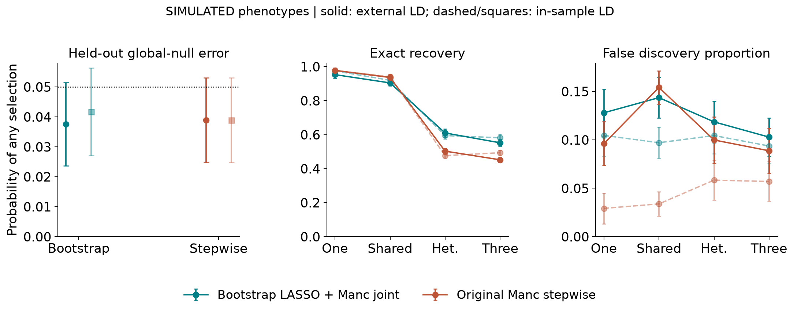
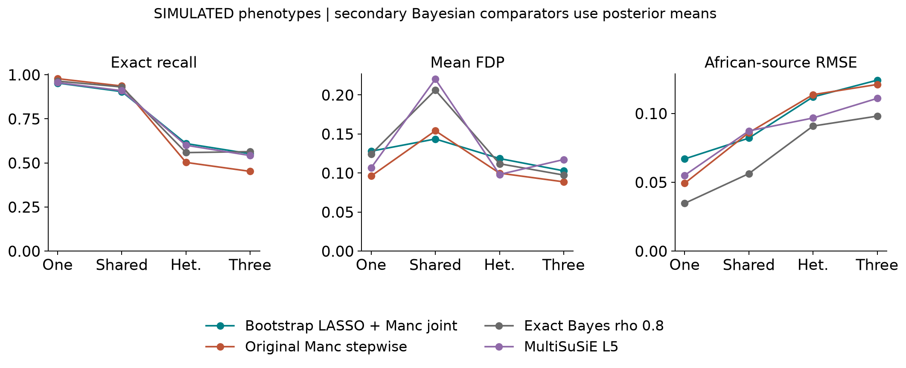
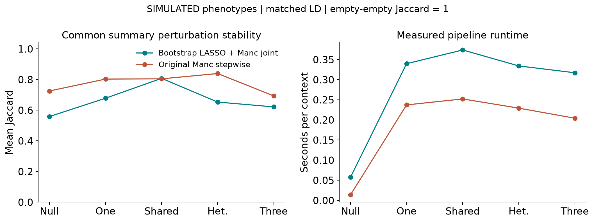

# Replacing Manc COJO stepwise selection with bootstrap LASSO

**Vusumuzi Mabasa**

This study tests an experimental replacement for the selection stage of Manc-COJO. It uses public CEU, YRI and LWK reference haplotypes to generate study genotypes; **every phenotype is simulated**. No AWI-Gen data, observed clinical outcomes or biological discoveries are claimed. The new pipeline is a wrapper using R bootstrap LASSO selection followed by the unchanged official Manc-COJO joint estimator. It is not an official release, forked executable or endorsement by the Manc-COJO authors.

[Word manuscript](report/Bootstrap_LASSO_Manc_COJO_Research_Report.docx) · [Protocol](protocol/design.json) · [Mathematical specification](protocol/methods.md) · [Audited results](results/validation_summary.tsv) · [Paired uncertainty](results/paired_differences.tsv) · [Workflow](workflow.txt)

## Abstract

**Background.** Replacing stepwise signal selection with bootstrap LASSO changes the statistical selection rule, even when summary inputs and subsequent joint estimation are held fixed. The relevant comparison is therefore between complete pipelines with a shared estimation interface.

**Methods.** The primary comparison used original Manc-COJO v1.1.0 selection versus an R ordinary LASSO selector fitted to a parametric bootstrap of ancestry-specific summary likelihoods. Both used the same harmonized marginal statistics, signed LD and candidate variants, and the official joint estimator. Independent tuning selected lambda 2.5; separate null simulations calibrated selection cutoffs before fresh validation. Validation comprised 2,388 calibration and 2,160 evaluation datasets across 12 fixed strata, analysed under matched external and in-sample LD. Exact Bayesian and MultiSuSiE models were secondary comparators.

**Results.** With matched external LD, bootstrap selection had a held-out global-null rate of 0.037, compared with 0.039 for original stepwise selection. Shared-effect exact recall and mean FDP were 0.904 and 0.144 for the replacement, versus 0.936 and 0.154 for the original. In the heterogeneous setting, the paired recall change was 0.107 (0.082 to 0.132). All 17,280 evaluation method rows passed completeness and numerical reconstruction checks.

**Conclusion.** The replacement improved mean recovery in heterogeneous and three-causal settings, but reduced recovery in one-causal and shared-effect settings and required more computation. It did not consistently improve perturbation stability. Bootstrap frequencies are not posterior inclusion probabilities, valid post-selection confidence intervals or a guarantee of nonnull FDR control.

## Introduction

Conditional and joint GWAS analysis aims to separate association signals in the presence of linkage disequilibrium. Manc-COJO extends this analysis across populations with different LD structures [1]. Its selection stage uses conditional association evidence, while the final joint stage estimates effects for a retained set. A change in the selector should be assessed while preserving the surrounding data handling and estimation steps wherever feasible.

The research question is whether replacing Manc-COJO's forward and backward selection with bootstrap LASSO gives useful differences in error, recovery and stability. Ordinary LASSO produces sparse coefficient vectors; repeated bootstrap fits provide an empirical selection frequency [2,3]. That frequency describes sensitivity to the stated resampling model. It is not interchangeable with a Bayesian probability or an error-controlled stability-selection procedure.

This project is independent of the [preceding public-reference study](https://github.com/Vusumuzi2Mabasa/Multiancestry_GWAS_Bayesian_Comparison/tree/03a5a07826a82380e6a1a9191d4f0a7f61f0f6af). It reuses its disjoint reference panels and simulated-effect architectures but uses new seeds and a new frozen protocol. The original project remains intact. All conclusions concern quantitative simulated traits in six sparse chromosome 22 regions. YRI and LWK identify specific source panels, not African genetic diversity as a whole.

## Methods

### Retained interfaces and changes

The upstream source at commit 296953627d2d2b7bc3bfa04cf65524c5013c3b41 separates selection (`src/slct_loop.cpp`, `MACOJO::slct_loop`) from the joint-only dispatcher (`src/macojo.cpp`, `MACOJO::entry_function`) and final estimator (`Cohort::calc_joint_effects`). Original selection adds conditional inverse-variance meta-analysis signals and can remove signals through backward selection. Our R selector replaces that entire search. Both pipelines use the original `--effect-mode GCTA` joint estimator, official collinearity checks (default 0.9), allele orientation, and the identical `.ma`, `.bim`, signed `.ld` and `.frq` files. Both apply the same explicit common eligibility mask with `--extract`; reference frequency differences must be strictly below 0.2 in both populations. LASSO passes its proposed set to `--cojo-joint --extract`. There is no subsequent stepwise P-value pruning in the replacement. Official joint estimation can remove collinear variants, which are counted and reported separately.

All eight marginal rows remain in each `.ma` file even when an extract mask is used. This matters: upstream `read_sumstat` computes phenotype variance from all parsed marginal rows, including rows outside the selected set. Truncating the `.ma` files to selected markers would change the joint estimator's scaling. Numerical controls compare the summary reconstruction with official coefficients and SEs, and replay stepwise selected sets through joint-only mode.

### Public references and simulated traits

The six GRCh37 chromosome 22 windows span 100 kb beginning at 20, 25, 30, 35, 40 and 45 Mb. The source study selected eight coordinate-spaced, complete phased PASS biallelic nonambiguous SNPs per window, with minor allele frequency at least 0.05 in each population and donor pool. Its thinning rejected haplotype pairwise squared correlations at least 0.95 and near-singular diploid LD matrices. The reused reference QC tables and signed LD are published in results/reference; the local haplotypes are authenticated by hashes. No new variant selection was based on phenotypes.

Each population has 40 external-reference donors. Disjoint study-generating pools contain 59 CEU, 68 YRI and 59 LWK donors. Each simulated participant independently draws two complete local haplotypes with replacement from the relevant study pool. This preserves local haplotype structure but adds neither new reference diversity nor between-region linkage. Cohorts contain 2,000 CEU and 250 YRI or LWK participants. For centered genotype matrix $X_k$, every phenotype is generated as

$$y_k=X_k\beta_k+\epsilon_k,\qquad \epsilon_k\sim N(0,I_{n_k}).$$

Effects are per additional alternate allele in residual-SD units. The null has all coefficients zero. The one-causal architecture uses marker 2 with effect 0.22 in both populations. Shared effects use markers 2 and 7, both 0.22 in both populations. At markers 2 and 7, heterogeneous effects are $(0.22,0)$ in CEU and $(0.10,0.28)$ in the African-source cohort. The three-causal architecture uses markers 2, 5 and 7 with CEU effects $(0.22,-0.16,0)$ and African-source effects $(0.10,-0.16,0.28)$. All other coefficients are zero. Marker numbering here is one-based; code and protocol arrays are zero-based.

### Working summary model

For population k and marker j, let b, s, f and N be the harmonized marginal coefficient, SE, effect-allele frequency and sample size. Reproduce the default GCTA scaling in upstream `src/read_files.cpp`:

$$v_{jk}=2f_{jk}(1-f_{jk}),\quad V_k=\operatorname{median}_j\{v_{jk}N_{jk}[s_{jk}^2+b_{jk}^2/(N_{jk}-1)]\},$$
$$n^{eff}_{jk}=(V_k/v_{jk}-b_{jk}^2)/s_{jk}^2+1,\quad d_{jk}=n^{eff}_{jk}v_{jk}.$$

On the eligible set, Q has diagonal d and off-diagonal entries

$$Q_{ij,k}=R_{ij,k}\min(n^{eff}_{ik},n^{eff}_{jk})\sqrt{v_{ik}v_{jk}},\qquad q_k=\operatorname{diag}(d_k)b_k.$$

The working likelihood is q conditional on beta distributed as normal with mean Q beta and covariance V Q. This covariance is an explicit approximation when Q is reconstructed with external LD, the total-phenotype proxy V, and effective sample sizes. It is not the exact finite-sample distribution of all reported GWAS statistics. No external-reference uncertainty, overlapping-cohort covariance or admixture is integrated. Population cohorts are independent; variants within populations remain correlated. We reject non-positive-definite matrices rather than conceal a repair.

Set $H_k=Q_k/V_k$, $S_k=\operatorname{diag}(\sqrt{\operatorname{diag}(H_k)})$, $A_k=S_k^{-1}H_kS_k^{-1}$, $z_k=S_k^{-1}q_k/V_k=S_kb_k$, and $t_k=S_k\beta_k$. Minimize

$$\sum_{k=1}^2\left\{\frac12t_k^TA_kt_k-z_k^Tt_k+\lambda\sum_j|t_{jk}|\right\}.$$

This is ordinary elementwise LASSO with population-specific coefficients and one shared tuning constant. It separates across populations; it neither pools effect estimates nor imposes shared support. A marker is selected in a replicate if either population has a nonzero coefficient. The allele-scale penalty is lambda times sqrt(d/V) times absolute beta; relative to the average per-population least-squares loss the coefficient threshold is proportional to sqrt(V/d), accommodating unequal information. It is not equal penalty strength per allele and not a group LASSO. Compared with Manc's fixed-effect inverse-variance meta-analysis selection criterion, union selection can retain population-specific or opposite-sign associations. That estimand change is intrinsic to this specified replacement, not a hidden claim of equivalence.

### Parametric bootstrap and lambda selection

For each population and bootstrap draw, generate z star = z + L e, where L L transpose = A and e is a fresh vector of independent standard normals. Equivalently q star is normal with mean q and covariance V Q. The center corresponds to the saturated pilot Q inverse q, which is feasible in these eight-marker positive-definite panels. This perturbs the observed fitted mean rather than generating a global-null bootstrap for every dataset. It can carry noise or external-LD artifacts into the resamples. The bootstrap leaves LD, sample sizes, allele frequencies and V fixed; it is not a participant bootstrap and cannot be applied to dense singular regions without a new specified pilot and regularization analysis.

Fit each bootstrap at the fixed lambda; do not retune lambda inside resamples. Selection frequency is the proportion of 100 union-support selections. Lambda is chosen globally from 1, 1.5, 2 and 2.5 using separate tuning simulations, according to the exact rule in design.json. This tuning uses simulated truth only in the development experiment; evaluation truth never determines lambda or thresholds. Independent null calibration then chooses a stratum-specific frequency cutoff. Given C calibration maxima, use rank ceiling((C+1)0.95) and strict exceedance. Ties can make the procedure conservative; a cutoff of one yields an empty selector and is not overridden. The final stage uses C=199 and independent evaluation streams. The same rank rule calibrates original Manc first-entry scores and secondary Bayesian maximum PIPs. This is empirical locus global-null calibration, not nonnull FDR control or a genome-wide significance recommendation.

### Diagnostics and evaluation

R vectorized coordinate descent solves many bootstrap columns simultaneously; every fit must pass the KKT residual tolerance of 1e-6. Controls compare glmnet on Cholesky pseudo-data, an orthogonal soft-threshold solution, allele flips, marker permutations, and Gaussian covariance. Separate genuine within-population row-bootstrap and fixed-design Gaussian residual simulations use regenerated participant data; these are diagnostics, not the primary method. Row resampling changes the empirical design while the primary parametric bootstrap holds it fixed, so identical frequencies are not expected.

All methods are evaluated on identical fresh simulated datasets, with both matched external LD and an in-sample LD diagnostic. Six fixed regions and CEU paired with YRI or LWK give 12 strata. Each stratum has 60 evaluation nulls and 30 of each of four alternatives, separate from 199 calibration nulls. Genotypes pair whole local haplotypes from the original disjoint study-generating pools; all phenotypes are newly simulated with noise SD one. The 2000 versus 250 sample-size imbalance and original one-, shared-, heterogeneous- and three-causal architectures are retained.

Primary coefficient comparisons use official joint estimates on the respective final selected sets, assigning zero elsewhere. These refits are descriptive post-selection estimates: official SEs are checked numerically but are not reported as valid post-selection confidence intervals. Secondary exact and MultiSuSiE models use their posterior mean estimators; selection scores are masked for ineligible variants, but their latent model retains all eight markers. This secondary-panel difference is disclosed rather than conflated with the primary controlled comparison.

Exact and one-to-one LD-aware recall use the original causal union as denominator, including causes removed by filtering. LD-aware matching uses study r squared at least 0.8 and is reported for each population. Error metrics include null any-selection probability, nonnull mean FDP, per-population all-marker MSE, and bias of the African-source effect 0.28. Monte Carlo intervals use fixed-stratum averages and within-dataset paired differences. They condition on the frozen calibration thresholds and donor panels.

Algorithmic repeat stability compares independent B100 draws on unchanged data. Common perturbation stability compares both primary pipelines after adding one identical working-model perturbation to marginal coefficients, holding marginal SEs and frequencies fixed and reconstructing each pipeline's scaling again. This is a defined summary perturbation diagnostic, not a new independent cohort or a calibrated bootstrap confidence region. Empty-empty Jaccard is one; null and signal strata are reported separately. B200 stability averages the two frequency runs and uses the same B100 cutoff only as a numerical sensitivity diagnostic, without claiming B200 error calibration.

### Scope and negative findings

No stability-selection FDR guarantee, Bayesian PIP interpretation or confidence-interval validity attaches to bootstrap frequencies. Small donor pools, sparse eight-marker regions and reuse of known development regions limit generalization. External LD error can affect both the selection objective and retained joint estimator. Failure or nonconvergence is recorded, never silently dropped; numerical or calibration failures stop the shard. New production results require the protocol, implementation and frozen choices to agree by hash. Results that favor the original method or reveal weak recovery must remain in the report.

## Results

### Numerical agreement and independent diagnostics

The R coordinate-descent solver agreed with glmnet to a maximum absolute coefficient difference of 1.4e-07. Orthogonal soft-threshold, allele-flip, marker-permutation and KKT controls passed. A 50,000-draw covariance control differed from its target by at most 0.011; the independent fixed-design residual simulation also passed its prespecified covariance tolerance. Production KKT residuals were at most 1.1e-07.

The independently reconstructed GCTA joint coefficients differed from the official executable by at most 3.5e-11; joint SE agreement was 3.8e-11. Replaying stepwise selected sets in joint-only mode gave maximum coefficient difference 0. These controls validate retained calculations; they do not validate post-selection inference or external-LD assumptions.

Six separate participant-level diagnostic datasets compared 500 genuine within-population row bootstraps with 500 summary parametric draws at lambda 1.5 and known noise variance one. Across 48 markers, mean absolute frequency difference was 0.023 and the maximum was 0.074. This is a descriptive diagnostic on a different, oracle-variance specification, not a substitution for the primary summary-input experiment or proof that the two bootstraps are equivalent.

### Independent tuning and calibration

The prespecified tuning rule selected lambda 2.5. Development results below use only two tuning regions paired with YRI. They were not pooled with validation, and final evaluation outcomes did not affect the choice. The lowest penalty can saturate bootstrap frequencies and yield a cutoff of one, causing an empty selector; this negative behavior was retained rather than bypassed.

| Lambda | Tuning null rate | Recall minus FDP |
| --- | --- | --- |
| 1 | 0.017 | 0.331 |
| 1.5 | 0.033 | 0.694 |
| 2 | 0.017 | 0.695 |
| 2.5 | 0.033 | 0.707 |

Table 1. Tuning results under matched external LD. Recall minus FDP is the prespecified development objective, not a clinical utility score or an FDR guarantee.

Fresh matched-LD bootstrap cutoffs ranged from 0.550 to 0.750 across the 12 strata. Every cutoff was saved and hashed before validation evaluation. Held-out null results use 720 datasets per method; rates estimate locus-level any-selection error conditional on the fixed panels and calibration thresholds. Pooled Wilson intervals are descriptive approximations; the primary MC SE uses the fixed-stratum formula and allows different rates across strata.

| Method | Null rate | MC SE | Wilson interval |
| --- | --- | --- | --- |
| Bootstrap LASSO plus Manc joint | 0.037 | 0.007 | 0.026 to 0.054 |
| Original Manc stepwise | 0.039 | 0.007 | 0.027 to 0.056 |
| Exact Bayes rho 0.8 | 0.039 | 0.007 | 0.027 to 0.056 |
| MultiSuSiE L5 | 0.047 | 0.008 | 0.034 to 0.065 |

Table 2. Fresh matched-reference global-null error. No genome-wide multiplicity or nonnull FDR interpretation is intended.

### Paired recovery and false discoveries

The shared and heterogeneous scenarios distinguish recovery of broadly shared effects from recovery of a population-specific effect in the smaller cohort. For shared effects, bootstrap recall changed by -0.032 (-0.049 to -0.015) relative to stepwise selection, and FDP changed by -0.011 (-0.032 to 0.011). In the heterogeneous setting, the corresponding FDP change was 0.019 (-0.009 to 0.046). These paired intervals use differences within the same simulated dataset and then aggregate equally across fixed strata.

| Scenario and method | Exact recall | LD recall AFR | Mean FDP | AFR RMSE |
| --- | --- | --- | --- | --- |
| One Bootstrap | 0.953 | 0.953 | 0.128 | 0.067 |
| One Stepwise | 0.978 | 0.978 | 0.096 | 0.049 |
| Shared Bootstrap | 0.904 | 0.904 | 0.144 | 0.082 |
| Shared Stepwise | 0.936 | 0.936 | 0.154 | 0.086 |
| Heterogeneous Bootstrap | 0.610 | 0.610 | 0.119 | 0.112 |
| Heterogeneous Stepwise | 0.503 | 0.503 | 0.100 | 0.114 |
| Three Bootstrap | 0.552 | 0.569 | 0.103 | 0.124 |
| Three Stepwise | 0.452 | 0.453 | 0.089 | 0.121 |

Table 3. Primary matched-LD results, 360 datasets per alternative and method. AFR is the African-source cohort. RMSE covers all eight coefficients, assigning zero to unselected markers. LD-aware recovery uses one-to-one matching and the original causal denominator.

| Scenario | Recall change and 95% MC interval | FDP change and 95% MC interval |
| --- | --- | --- |
| One | -0.025 (-0.042 to -0.008) | 0.032 (0.008 to 0.056) |
| Shared | -0.032 (-0.049 to -0.015) | -0.011 (-0.032 to 0.011) |
| Heterogeneous | 0.107 (0.082 to 0.132) | 0.019 (-0.009 to 0.046) |
| Three | 0.100 (0.079 to 0.121) | 0.014 (-0.011 to 0.040) |

Table 4. Replacement minus original stepwise selection. Positive recall changes indicate more causal retention; positive FDP changes indicate a larger false discovery proportion. Intervals quantify Monte Carlo uncertainty conditional on frozen settings.

The in-sample LD diagnostic changes the information supplied to both pipelines. Shared-effect FDP was 0.097 for the replacement and 0.034 for the original, compared with 0.144 and 0.154 under matched external LD. Thus error patterns must be interpreted jointly with LD source; this comparison does not show that bootstrap perturbation accounts for reference-panel uncertainty.

Figure 1. Primary null error, exact recovery and mean FDP. Solid curves and circles use matched external LD; dashed curves and lighter squares use in-sample LD. Error bars are 1.96 Monte Carlo SEs. Global-null calibration does not constrain alternative FDP.

### Effect estimation and secondary Bayesian comparisons

Both primary pipelines use the official joint estimator on their own selected sets. The mean estimated African-source effect at the population-specific marker, whose generating effect is 0.28, was 0.103 for bootstrap selection and 0.026 for stepwise selection. These averages include zero when the marker was not retained; they combine selection loss and estimation error. The paired African-source all-marker MSE difference in this scenario was -0.000 (-0.002 to 0.001). There are no post-selection confidence-interval claims.

Exact Bayes and MultiSuSiE provide secondary comparisons with different priors and estimators. In the shared matched-LD setting, their recall was 0.931 and 0.910, with mean FDP 0.206 and 0.220, respectively. Their posterior means use shrinkage across all markers, whereas the two primary pipelines refit selected sets. These comparisons contextualize the tradeoffs but do not isolate the selector as directly as the original-versus-replacement comparison.

Figure 2. Secondary matched-reference comparisons of recovery, FDP and coefficient RMSE. Bayesian PIPs and bootstrap frequencies have distinct meanings and independently calibrated cutoffs. Full numerical estimates and paired uncertainty are supplied in the result tables.

### Stability runtime and fit accounting

Bootstrap repeat stability measures Monte Carlo sensitivity of the new selector on unchanged data. Common perturbation stability applies the same marginal-statistic perturbation to both pipelines. Each stability entry averages 60 paired cases per scenario and LD condition, selected by replicate index before observing results. A null empty-empty comparison scores one, so null Jaccard values should not be interpreted as evidence of informative recovery.

| Scenario | Bootstrap repeat Jaccard | Bootstrap perturb Jaccard | Stepwise perturb Jaccard |
| --- | --- | --- | --- |
| Null | 1.000 | 0.558 | 0.725 |
| One | 0.953 | 0.678 | 0.803 |
| Shared | 0.929 | 0.807 | 0.804 |
| Heterogeneous | 0.958 | 0.653 | 0.839 |
| Three | 0.917 | 0.621 | 0.693 |

Table 5. Matched-LD stability. Algorithmic repeat Jaccard and common perturbation Jaccard answer different questions. The B200 diagnostic is available in the complete summary and uses the original B100 cutoff without recalibration.

Bootstrap aggregation did not automatically improve stability. In heterogeneous matched-LD cases, common-perturbation Jaccard was 0.653 for the replacement versus 0.839 for stepwise selection. Greater causal recovery therefore coexisted with lower stability under this particular perturbation. The perturbation experiment is not a held-out global-null test and has no claimed error calibration.

For shared matched-LD cases, measured average runtime was 0.374 seconds for the replacement and 0.252 seconds for original stepwise selection. Replacement timings include R fitting time and official joint-process wall time; batched R startup and serialization are recorded separately in shard completion files. Repeated stability fits are excluded from primary timings. Null original fits may use a numerically checked no-entry screen. These implementation timings include file and process overhead, depend on the Toshiba drive and concurrent workloads, and are not a universal algorithmic speed ranking.

Figure 3. Common-perturbation stability and measured runtime under matched external LD. Both pipelines receive the same perturbed summary input in each stability comparison.

The audit retained all 17,280 evaluation rows and 138,240 per-variant records. There were 0 failed fits and 0 finite nonconverged Bayesian fits. Official joint safeguards removed 67 proposed markers across the recorded primary replacement contexts. Causal-filter accounting and proposed-versus-final counts remain in each metric row; recall never drops filtered causal variants from its denominator. Reconstructed MSEs agreed with saved metrics to 1.1e-16.

## Discussion

The clearest favorable recovery changes occurred in heterogeneous and three-causal settings, with paired recall increases of 0.107 (0.082 to 0.132) and 0.100 (0.079 to 0.121). The one-causal setting gave an unfavorable combination: recall changed by -0.025 (-0.042 to -0.008) and FDP by 0.032 (0.008 to 0.056). Shared-effect recall also decreased. The heterogeneous FDP interval spans zero, so its positive mean difference alone does not establish a reproducible increase at this simulation precision. These findings argue against replacing the original selector unconditionally.

Replacing stepwise selection is a change in the objective and in the way evidence is combined, not merely a different search for an identical optimum. The specified LASSO uses separate population coefficients and selects the union of their supports. It can retain a population-specific signal without strong fixed-effect meta-analysis evidence, but it also creates additional routes for noise to enter. Independent global-null calibration makes the comparison more interpretable without forcing the same alternative FDP.

The parametric bootstrap makes the summary-input replacement possible, but it conditions on the supplied LD and estimated variance. It cannot repair biased external LD by repeatedly drawing from that same working model. The saturated pilot also propagates observed noise. The in-sample control and participant-level diagnostic help locate these assumptions; neither turns the primary frequencies into calibrated posterior probabilities.

The preserved joint estimator is a strength of the comparison. Any change in the primary final estimates arises from the selected set and the official safeguards, not an undisclosed switch to a new coefficient estimator. Its unadjusted SEs remain unsuitable as a general post-selection inferential guarantee. A scientifically useful result may therefore be a recovery improvement accompanied by extra FDP, or a failure of bootstrap selection to improve a target metric. The tables retain both directions of change.

## Limitations

Only eight variants per region and six chromosome 22 windows are analysed. The fixed reference pools are small, study participants are resampled haplotype pairs, and there is no admixture, relatedness, binary trait, genotype missingness or overlapping-cohort model. Sparse positive-definite panels permit an unregularized saturated pilot; dense or singular regions require a newly specified method and validation. The standalone interface is intentionally restricted to the tested two-cohort, eight-marker, constant-N setting.

Lambda tuning covered two regions and one African-source panel. Fresh seeds prevent outcome leakage, but the same underlying donor pools and some regions recur in validation. Monte Carlo intervals do not capture donor-panel uncertainty, tuning uncertainty or the distribution of future genomic regions. The 100-draw frequency grid produces ties, and B200 sensitivity is not independently recalibrated. Secondary Bayesian methods use distinct latent inclusion and coefficient models. Runtime is implementation- and hardware-dependent.

No ordinary-bootstrap stability-selection FDR theorem is claimed. This experiment supplies neither a genome-wide threshold nor a biological-discovery result, and it does not establish a universally superior replacement for Manc-COJO.

## Conclusion

An R bootstrap LASSO selector can replace the stepwise stage in a Manc-COJO workflow while retaining the official joint-estimation implementation. In this experiment it improved recovery of heterogeneous and three-causal signals, but reduced one-causal and shared-effect recovery, cost additional runtime, and did not consistently improve perturbation stability. The reviewed wrapper and paired validation make these tradeoffs reproducible; they do not establish a generally superior replacement or a biological finding.

## Reproducibility and availability

All project files are stored locally on Toshiba. The source, audited results, figures and Word manuscript are available in the public [GitHub repository](https://github.com/Vusumuzi2Mabasa/Multiancestry_Bootstrap_LASSO). The predecessor repository is preserved. The [workflow](workflow.txt) gives commands for provenance verification, numerical controls, independent tuning, threshold freezing, validation, auditing and manuscript generation. Invoke every Rscript with `--vanilla`; personal R startup files are never read.

Public-reference genotype derivatives stay in ignored `data/local/`; raw genotypes and donor identifiers are not committed. [Provenance](results/provenance.json) records exact input hashes and the official executable identity. Reproduction requires those verified local inputs or regeneration using the pinned source study's public-data preparation workflow. [Fit statuses](results/fit_status.tsv), [audit](results/audit.json), [thresholds](results/threshold_summary.tsv) and all per-replicate tables are retained. The Word manuscript is generated from this README with native editable equations and author Vusumuzi Mabasa.

## References

1. Wang X, Wang Y, Yang J, Visscher PM, Wray NR, Yengo L. Multiancestry conditional and joint analysis applied to GWAS summary statistics. Nature Genetics (2026). [doi:10.1038/s41588-026-02799-1](https://doi.org/10.1038/s41588-026-02799-1). [Official source](https://github.com/light156/multi-ancestry-COJO/tree/296953627d2d2b7bc3bfa04cf65524c5013c3b41) and [command interfaces](https://light156.github.io/multi-ancestry-COJO-docs/options/).
2. Bach FR. Bolasso Model consistent Lasso estimation through the bootstrap. ICML (2008). [doi:10.1145/1390156.1390161](https://doi.org/10.1145/1390156.1390161). This study uses thresholded parametric-bootstrap frequencies, not the exact Bolasso support-intersection procedure or a claimed transfer of its asymptotic theorem.
3. Friedman J, Hastie T, Tibshirani R. Regularization paths for generalized linear models via coordinate descent. Journal of Statistical Software (2010). [doi:10.18637/jss.v033.i01](https://doi.org/10.18637/jss.v033.i01). [glmnet documentation](https://glmnet.stanford.edu/articles/glmnet.html).
4. The 1000 Genomes Project Consortium. A global reference for human genetic variation. Nature (2015). [doi:10.1038/nature15393](https://doi.org/10.1038/nature15393). [IGSR data reuse](https://www.internationalgenome.org/IGSR_disclaimer/).
5. Rossen J, Shi H, Strober BJ, et al. MultiSuSiE improves multi-ancestry fine-mapping in All of Us whole-genome sequencing data. Nature Genetics (2026). [doi:10.1038/s41588-025-02450-5](https://doi.org/10.1038/s41588-025-02450-5). Used as an external secondary implementation; no All of Us data are analysed here.
